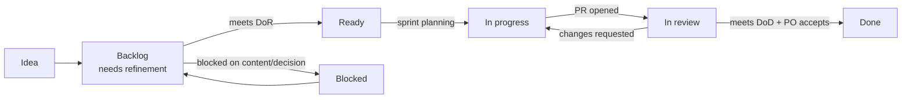

# Agile delivery process

This project is delivered with **Scrum**, adapted for a small team. This page is the entry point to
every agile artefact in the repository.

| Artefact                                        | Purpose                                                       |
| ----------------------------------------------- | ------------------------------------------------------------- |
| [Product vision](./product-vision.md)           | Why the product exists, who it serves, how we measure success |
| [Product backlog](./product-backlog.md)         | Ordered list of epics and user stories with estimates         |
| [Definition of Ready](./definition-of-ready.md) | When a story may enter a sprint                               |
| [Definition of Done](./definition-of-done.md)   | When a story counts as finished                               |
| [Release plan](./release-plan.md)               | Sprint-to-version mapping, velocity and roadmap               |
| [Sprints](./sprints/)                           | Plan, review and retrospective for each sprint                |
| [Sprint template](./sprints/_template.md)       | Copy this to start a new sprint                               |

## Roles

| Role             | Responsibility                                                     | Who                             |
| ---------------- | ------------------------------------------------------------------ | ------------------------------- |
| Product Owner    | Owns the backlog order, accepts stories, supplies business content | ARAC Polywrap management        |
| Scrum Master     | Facilitates ceremonies, removes impediments, guards the process    | Md Raiyan Alam                  |
| Development Team | Designs, builds, tests and documents the increment                 | Md Raiyan Alam (+ contributors) |

## Cadence and ceremonies

Sprints are **one week** long. Each sprint produces a potentially shippable increment, tagged in git
as a [semantic version](https://semver.org/) (see the [release plan](./release-plan.md)).

| Ceremony             | When              | Timebox | Output                                        |
| -------------------- | ----------------- | ------- | --------------------------------------------- |
| Backlog refinement   | Mid-sprint        | 1 h     | Stories meet the Definition of Ready          |
| Sprint planning      | Sprint day 1      | 1 h     | Sprint goal + committed stories in `sprints/` |
| Daily stand-up       | Every working day | 15 min  | Impediments raised on the board               |
| Sprint review        | Last day          | 45 min  | Demo of the increment, PO acceptance          |
| Sprint retrospective | Last day          | 30 min  | 1–3 improvement actions, tracked next sprint  |

## Story lifecycle

The GitHub project board mirrors these columns. Issues are created from the
[user story](../../.github/ISSUE_TEMPLATE/user_story.yml) and
[bug report](../../.github/ISSUE_TEMPLATE/bug_report.yml) templates.

## Estimation

- **Story points** on a modified Fibonacci scale: 1, 2, 3, 5, 8. Anything estimated at 13 is split.
- Points measure relative complexity and risk, not hours.
- **Priority** uses MoSCoW: _Must_, _Should_, _Could_, _Won't (this release)_.

## Traceability

Every story has an ID (`APW-###`). The ID appears in:

1. the backlog and the sprint document,
2. the commit footer (`Refs: APW-011`), enforced by review, and
3. the pull-request description.

So `git log --grep "APW-011"` lists every change made for a story.
