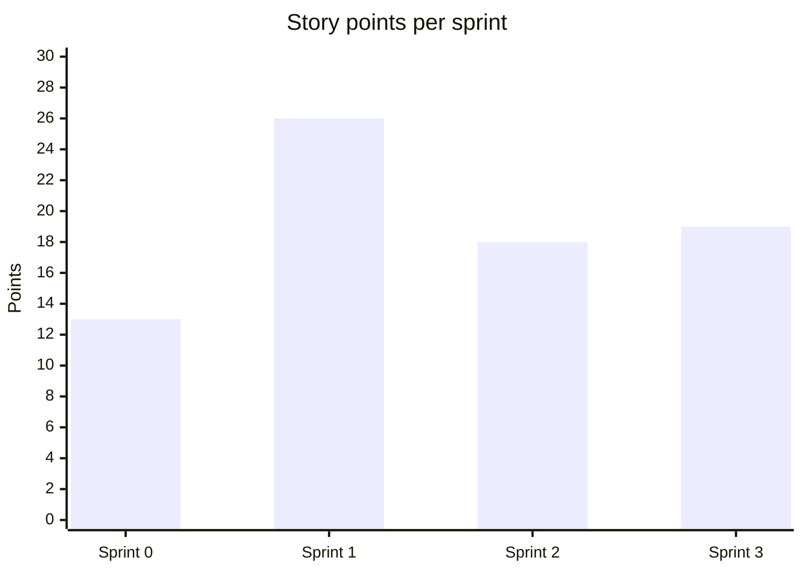

# Release plan

Each sprint ends with a tagged, potentially shippable increment. Versions follow
[Semantic Versioning](https://semver.org/): `0.x` while the site reaches parity, `1.0.0` when it is
production-ready.

| Sprint | Theme                                      | Version  | Planned pts | Done pts | Status      |
| ------ | ------------------------------------------ | -------- | ----------: | -------: | ----------- |
| 0      | Discovery and foundations                  | `v0.1.0` |          13 |       13 | Released    |
| 1      | MVP parity with the legacy site            | `v0.2.0` |          26 |       26 | Released    |
| 2      | Close legacy gaps, new sections            | `v0.3.0` |          18 |       18 | Released    |
| 3      | Production readiness                       | `v1.0.0` |          17 |       19 | Released    |
| 4      | Free hosting on GitHub Pages (release 1.1) | `v1.1.0` |           5 |        6 | In progress |

## Velocity

Average velocity over the delivery sprints (1–3) is **21 points**. Sprint 3 includes 2 unplanned
points (APW-046). Use about 20 points per sprint when planning release 1.1.

## Roadmap after v1.0

Release 1.1 and later will draw from epic **E5**, ordered by the Product Owner. Candidates:
enquiry form (APW-050), product detail pages (APW-056), Bangla localisation (APW-051),
analytics (APW-053) and a headless CMS (APW-052).

**Launch blockers** (need the Product Owner, not development): APW-054 (approved content) and
APW-055 (vector logo and photo licences).
