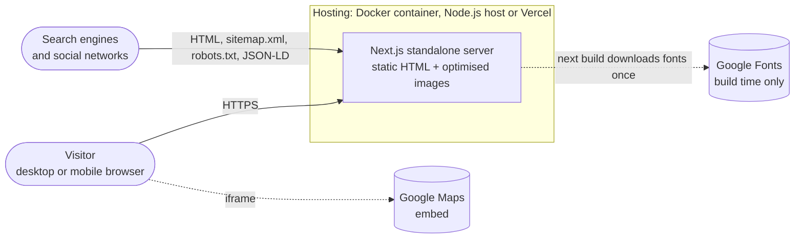
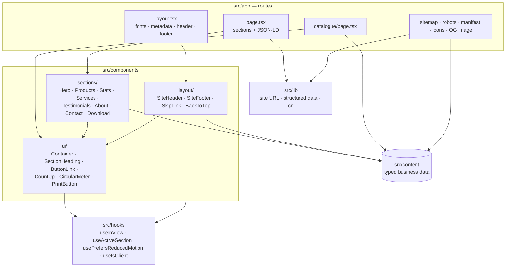
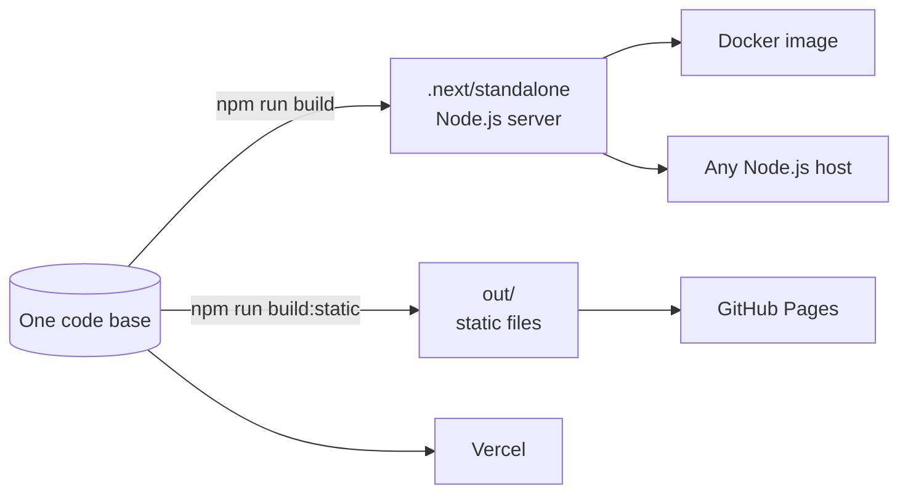

# Architecture overview

This page explains how the website is put together and why. Detailed reasoning for individual
choices lives in the [architecture decision records](./adr/README.md).

## System context

- There is **no database, CMS or API**. All content ships with the code from `src/content/`.
- The only third-party request a visitor's browser makes is the Google Maps iframe in the
  contact section (lazy-loaded). Fonts are downloaded at build time and self-hosted.

## Rendering strategy

| Route                                                  | Rendering                     | Notes                                   |
| ------------------------------------------------------ | ----------------------------- | --------------------------------------- |
| `/`                                                    | Static (prerendered at build) | Footer year is corrected in the browser |
| `/catalogue`                                           | Static                        | Same data as `/`, print-optimised       |
| `/_not-found`                                          | Static                        | Branded 404, `noindex`                  |
| `/sitemap.xml`, `/robots.txt`, `/manifest.webmanifest` | Static                        | Generated from `src/app/*.ts`           |
| `/icon.svg`, `/apple-icon.png`, `/opengraph-image.jpg` | Static                        | File-based metadata                     |

Every route is prerendered once at build time; nothing renders per request. Cache Components is
**off** ([ADR 0009](./adr/0009-static-export-for-github-pages.md)) because it cannot be combined
with the static export in Next.js 16.4. The only time-dependent value, the copyright year, is
rendered at build time and corrected in the browser by a small client component.

## Code organisation

**Dependency rule:** `app` → `components` → `ui`/`hooks` → `lib`, and anything may read `content`.
`content` depends on nothing but its own types and image assets, so it can later be swapped for a
CMS (backlog item APW-052) without touching components.

## Content model

All types are in [`src/content/types.ts`](../../src/content/types.ts).

| Module            | Exports                                                           | Used by                                      |
| ----------------- | ----------------------------------------------------------------- | -------------------------------------------- |
| `company.ts`      | name, contact details, addresses, map, social links, brochure URL | header, footer, contact, catalogue, JSON-LD  |
| `navigation.ts`   | `primaryNavigation`, `sectionHref()`                              | header, footer                               |
| `hero.ts`         | `heroSlides`                                                      | hero carousel                                |
| `products.ts`     | `products`                                                        | products section, catalogue, footer, JSON-LD |
| `stats.ts`        | `stats`                                                           | stats section, services copy                 |
| `services.ts`     | `services`                                                        | services section                             |
| `testimonials.ts` | `testimonials`, `serviceLevels`                                   | testimonials section                         |
| `about.ts`        | `about`                                                           | about section                                |
| `sections.ts`     | `sectionCopy` (headings and intros)                               | all sections, catalogue                      |

`src/content/content.test.ts` enforces invariants: unique product slugs, every link target exists,
percentages within 0–100, and illustrative testimonials are flagged.

## Server and client components

Everything is a Server Component unless it needs browser state. The client components are small
leaves, so the page ships very little JavaScript.

| Client component | Why it runs in the browser                                    |
| ---------------- | ------------------------------------------------------------- |
| `SiteHeader`     | Mobile-menu state, scroll shadow, active-section highlighting |
| `HeroCarousel`   | Slide state, autoplay timer, swipe and hover handling         |
| `CountUp`        | Count-up animation when scrolled into view                    |
| `CircularMeter`  | Ring fill animation when scrolled into view                   |
| `BackToTop`      | Scroll position, scrolling and focus management               |
| `PrintButton`    | Calls `window.print()`                                        |
| `CopyrightYears` | Corrects the build-time year to the visitor's current year    |
| `error.tsx`      | Error boundaries must be client components                    |

Animated components render their **final state on the server** (numbers, filled rings), so the
page is complete without JavaScript and for search engines. After hydration they reset and
animate only if the visitor has not asked for reduced motion.

## Navigation design

- Menu links are absolute anchors (`/#products`). On the home page they scroll smoothly; from
  `/catalogue` they navigate home and then scroll. Without JavaScript they still work as plain
  links. This was the main bug in the legacy site.
- `scroll-padding-top` on `<html>` keeps targets clear of the sticky header.
  `data-scroll-behavior="smooth"` tells Next.js 16 how to treat smooth scrolling during route
  changes.
- `useActiveSection` observes a thin band just above the middle of the viewport with
  `IntersectionObserver` and marks the matching menu link `aria-current="true"`.

## Accessibility design

- Landmarks (`header`, `nav` ×2, `main`, `footer`), one `h1` per page, ordered headings, skip link.
- Carousel follows the WAI-ARIA APG carousel pattern: pause control, no autoplay with reduced
  motion, inert hidden slides, live region only when not rotating.
- Statistics expose the final number to screen readers; service levels use the ARIA `meter` role.
- Brand colours were chosen for WCAG AA contrast (white text sits on `accent-600`, not the
  lighter logo red).
- axe-core runs in CI on every page; Lighthouse accessibility score is 100.

## Performance design

- Static prerendering, statically imported images (automatic dimensions, AVIF/WebP, responsive
  `srcset`) and self-hosted variable fonts with `display: swap`.
- The first hero image is preloaded as the LCP element; other slides load only when they are
  next in line.
- Paint-heavy effects (backdrop blur, full-screen blur placeholders, CSS filters on large
  images) are avoided. Removing them in Sprint 3 cut mobile Total Blocking Time from 1.9 s to about
  0.1 s.

## Security design

See [SECURITY.md](../../SECURITY.md) and [ADR 0007](./adr/0007-csp-without-nonces.md). Headers are
defined once in `next.config.ts` and asserted by `e2e/security.spec.ts`.

## Deployment architecture

`next build` with `output: "standalone"` produces `.next/standalone/server.js` plus the minimal
`node_modules` it needs. A `postbuild` script copies `public/` and `.next/static/` into it, so the
same self-contained folder is used by `npm start`, the E2E tests and the Docker image. See the
[deployment guide](../guides/deployment.md).

With `STATIC_EXPORT=true` (`npm run build:static`) the same code is exported as plain files to
`out/` for GitHub Pages: `output: "export"`, `trailingSlash: true`, unoptimised images, a
`basePath` for project sites, and a `<meta>` Content Security Policy in place of HTTP headers.
`.github/workflows/deploy-pages.yml` tests and publishes it. See the
[GitHub guide](../guides/github.md).

